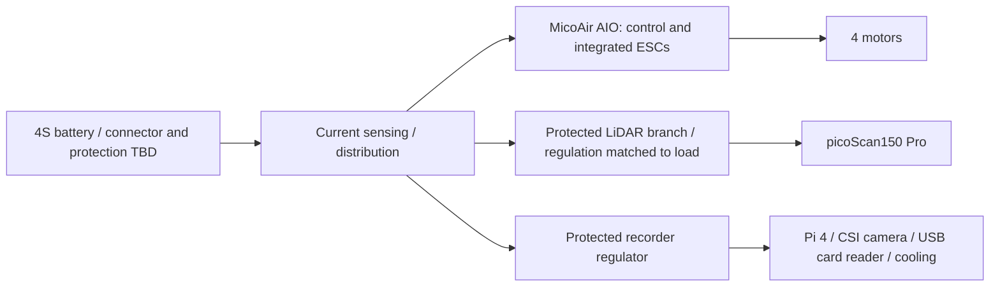

# Installed design and assembly plan — PW-APPROACH-01

Updated November 16, 2026 from SRC-034 §3.4. **Selected conceptual installation; fabrication drawings, wiring pin map, exact power parts, and commissioning evidence remain pending.** Do not energize hardware from this outline alone.

## Configuration and interactions

Custom 500 mm carbon-fiber/PA6-CF hybrid frame; MicoAir H743v2-AIO-35A with integrated ESCs/PX4 1.16.0; M10G navigation; four X2216 880 KV motors and MR 10 × 4.5 props; 4S 5,200 mAh pack. Pi 4 records picoScan150 Pro Ethernet, Camera Module 3 CSI, and serial MAVLink pose to a separate 128 GB USB survey card. Pocket/RP1 V2 supplies RC/intended alerts; separate MAVLink serves the laptop. See [system architecture](../system/architecture.md), [interfaces](interfaces.csv), and [BOM](../procurement/bom.csv).

For existing bench setup and login use [Pi access](raspberry-pi-access.md). SRC-039–041 record Pi4/Bullseye/32GB boot media and November16 OpenSSH via Tailscale; these are starting inventory/access observations, not qualification of the intended camera/capture stack. Avoid rerunning card/account setup as a connection step; retain existing projects and the documented unrepaired-filesystem decision. Use the provided shared private key with pavewatch per D-026; read the Pi home README.md/AGENTS.md before working in /home/pavewatch/03-sensor-payload-acquisition and verify the host identity; individual Tailscale access remains required. Direct Ethernet maintenance and LiDAR Ethernet/PTP are different topologies.

## Electrical design to release

Separate sensor and recorder branches are intentional. FP must specify control-power topology/peripheral limits and protection for both payload branches. Source sensor range is 9–30 V; chosen pack full/low/transient input, regulator output/rating, fuses, grounds and startup remain to be documented. Do not power the Pi from an unqualified FC output or parallel regulator outputs.

Release a pin map for IF-01–13: connector/gender/keying/orientation, pin/net/polarity, voltage/logic/current, gauge/length, shielding/ground, protection, strain relief, and mating BOM rows. Allocate motor outputs and GNSS/compass, RP1, laptop telemetry and recorder UARTs without conflicts. Verify exact PX4 build/ports, receiver protocol, sensor plug, CSI ribbon orientation, and card reader. Earlier H7/Pixhawk pin maps are historical alternatives.

## Mechanical installation to detail

- CNC carbon-fiber plates and tube arms form the primary load path. PA6-CF clamps, landing fittings, sensor carrier, and electronics mounts require dimensions, fasteners, material/process and load checks. X500 v2 CAD is a dimensional reference only.
- Camera and LiDAR share a **rigid removable plate below the aircraft**, near the intended CG with downward camera and transverse LiDAR plane. If isolation is needed, isolate the whole plate; record its possible body-relative motion and recalibrate/check transforms after remounting.
- Reserve **120 × 100 × 130 mm** for sensors/connectors and **120 × 90 × 60 mm** for recorder assembly. These are envelopes, not demonstrated fit. Show cable exits/bends, camera ribbon strain relief, landing/prop/optical clearance, plate fasteners, and service removal.
- Pi, USB card reader and regulator share an electronics tray under a **ventilated PETG/ASA cover** with labeled connections and access for setup, data removal and shutdown. Retain card/reader against vibration; preserve airflow. No enclosure dust/water rating is claimed.
- Put GNSS/compass on a non-magnetic mast away from battery/motor wiring. Locate the 4S battery using installed CG and retention checks. Weigh every installed item and reconcile the 440–550 g sensing estimate, 650 g target and 2.25 kg all-up target.

## Assembly and commissioning sequence

1. Inventory label/revision/accessories/ownership, including the sensor reported received, 4S charging provision, receiver/cells and all harnesses. Record versions and procurement evidence.
2. Release dimensioned fabrication/layout/pin drawings and a single BOM. Inspect fabricated structure/fasteners/clearances; leave propulsion disabled during electrical commissioning.
3. Verify polarity/continuity/isolation, branch protection and ratings. Start from a qualified bench supply; log startup, simultaneous load, rail droop, thermals and faults.
4. Configure PX4 1.16.0/exact target, QGroundControl version, ports, receiver/ELRS/EdgeTX, GNSS/compass and battery monitor. Freeze Pi OS/Python/library versions and recorder configuration. Do not assume cited firmware support equals tested support.
5. Commission LiDAR profile/Compact stream and licensed software PTP with Pi grandmaster; verify actual epoch/timescale/lock. Configure camera native timestamp semantics, applied mode line controls and row mapping; record boot/realtime sample triplets, FC mapping and invalid clock segments per [timing plan](camera-lidar-timing.md). Qualify the separately identified binned/SSD bench profile and actual full-mode/USB-card flight stack, including sustained writes/thermal demand.
6. Integrate MAVLink pose, HealthMonitor, manifests and incomplete-run recovery. Inject faults through the Pocket bridge and laptop display; verify separate/shared link failures and freshness.
7. Calibrate with real optical-edge/photodiode and encoder motion references, including multiple exposures/row phases and both travel directions; freeze timing calibration and score a fresh ≥10 min loaded run. Report proposed 3 ms P95/±1 ms median/1 ms drift goals separately from SA2 ≤20 ms, and geometry projection errors separately from timing. Retain all clock/profile/media IDs, reference uncertainty and gaps. Execute ground range/pose/processing and three ≥1 GB export checks.
8. Complete installed mass/CG, matched thrust/current and energy/reserve checks. Resolve Q-17 speed/Q-18 endurance before claiming requirement compliance; only then plan appropriate authorized loaded flight evaluation.

## Operation and recovery contract

Preflight verifies aircraft/mission/configuration identity, actual home/pose, calibration/clock readiness, sensor/storage health and energy. Recording start is acknowledged separately from arming/takeoff. Pilot launch is deliberate. Record pause/takeover/detour/skip/resume/return/landing events and partial coverage; no reconnect or cleared sensor automatically resumes a mission.

Define behavior for full storage, sensor loss, invalid/stale pose, recorder brownout/reboot, lost heartbeat, low battery, and RC versus separate GCS loss. Persist gaps/validity; recorder faults do not transfer flight-control authority. Prior desired proximity stopping/hold remains pending exact hardware and PX4 mode integration.

After landing/disarming, stop/flush capture, finalize manifest/checksums/completeness, integrity-check a copy through ExportService, and shut down before removing power/media. An interrupted run remains incomplete; retain usable files and recovery evidence. Upload for hosted reporting when connected, preserving a local verified package and quality warnings.

## Review package

Release exact drawings/configuration/BOM, delivered costs against both ceilings, measured fit/power/mass and reserve margins, unresolved dependencies, and requirement/test evidence. This plan records intended work and contains no executed commissioning results.
