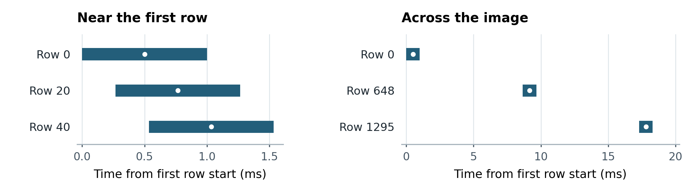

# Camera and LiDAR timing design

Incorporated November 16, 2026 from **SRC-036, PaveWatch_Camera_and_LiDAR_Timing.docx**, supplied by the user. This is the working timing plan for PW-APPROACH-01, with proposed calibration and validation. No hardware timing results were supplied or measured here. See the [source record](../references/new-evidence/2026-11-16-camera-lidar-timing.md), [original DOCX](../references/new-evidence/2026-11-16-camera-lidar-timing/PaveWatch_Camera_and_LiDAR_Timing.docx), and [shared frame contract](time-and-frames.md).

## Scope and capture profiles

Estimate when each camera row integrated light and each LiDAR beam measured pavement. Map these observations and flight-controller poses into one clock segment, then compensate the aircraft's motion between their acquisition times. Network receive time, JPEG completion, and frame cadence do not establish measurement time.

| Setting | First timing bench profile — SRC-036 | Flight planning profile — SRC-034/D-019 |
| --- | --- | --- |
| Geometry | 3 m example distance; 0.25–0.5 m/s; budget at 0.5 m/s | 5–8 m, approximately 0.25–1 m/s |
| Camera | 2304 × 1296, 10-bit, 2 × 2 binned, HDR off | 4608 × 2592 / 11.9 MP JPEG |
| Exposure/cadence | About 1 ms; 10–15 recorded frames/s | ≤1 ms; 3 recorded frames/s; locked focus |
| Storage | Source calls for SSD during loaded timing tests | Extreme128GB card in USB3 reader, separate OS card |
| LiDAR | Compact UDP; Pi4 software PTP grandmaster; 25 Hz is a beam-revisit example | ~50 Hz/0.25°–0.33° conditional on an available scan profile |

The bench profile is a characterization starting point, not an amendment of flight height/speed, the selected survey medium, or the aircraft budget. Keep separately identified configurations. If an SSD is used, inventory/borrow/price it as conditional ground-test equipment and identify the actual capture encoding and bytes per frame; 10-bit sensor input does not specify the stored encoding. A bench run on SSD does not qualify the USB survey card. Repeat timing and recording checks on the actual flight settings/media before claiming installed performance. Do not reuse full-resolution 3 fps file-rate estimates for the binned 10–15 fps profile.

## Camera line time and exposure time

The source uses non-HDR IMX708 driver mode values from `rpi-6.18.y`. These are calculated inputs pending installed-driver/configuration checks:

```text
tau = (W + B_h) / f_p
sweep = (H - 1) * tau
first_exposure_start_to_last_exposure_end = sweep + E
```

`W`/`H` are sensor output columns/rows, `B_h` is horizontal blanking in pixel-clock periods, `f_p` is pixel rate, and `E` is the applied exposure duration. Line time and exposure duration are different: neighboring rows' exposures overlap. Increasing vertical blanking changes frame cadence without necessarily changing line time; a shorter exposure reduces within-row blur without eliminating the row sweep.

| Non-HDR mode | Periods per line | Pixel rate | Calculated line interval | First-to-last row sweep |
| --- | --- | --- | --- | --- |
| 2304 × 1296 binned | 7,824 | 585.6 MHz | 13.36 µs | 17.30 ms |
| 4608 × 2592 full | 15,648 | 595.2 MHz | 26.29 µs | 68.12 ms |

Request the intended sensor output size/bit depth, inspect the applied Picamera2 configuration, identify the IMX708 subdevice in the media graph, and read active horizontal blanking/pixel rate. Preserve kernel/driver/library revisions and applied controls. Example inspection commands from the source:

```sh
rpicam-hello --list-cameras
v4l2-ctl -d /dev/v4l-subdevX --list-ctrls
```

Replace `X` with the identified sensor subdevice. Do not infer active mode or line time solely from the saved image dimensions. The binned mode's 17.30 ms sweep does not apply to the full-resolution flight profile.



Figure 1 is an unmodified illustration extracted from SRC-036 (SRC-038), not a measured exposure trace.

## Row exposure timestamp and calibration

Pair each image with metadata from the **same captured request**. Convert `ExposureTime` from microseconds to nanoseconds. The source proposes this model when `SensorTimestamp` corresponds to first-pixel readout:

```text
E_ns = ExposureTime_us * 1000
t_mid_native(y) = SensorTimestamp_ns - E_ns/2 + y * tau_ns + delta_ns
```

`y` is the zero-based row in original sensor readout order; in 2 × 2 binned mode it counts binned output rows. `delta` is observed optical time minus predicted time. Start calibration with zero offset, then fit and version its measured value. A row starts/ends exposure at `t_mid - E/2` / `t_mid + E/2`; a midpoint approximation still integrates motion over the exposure.

**Timestamp semantics must be checked on the installed stack.** SRC-036 distinguishes Picamera2/Pi4 Unicam readout/frame-start behavior from generic libcamera first-row-exposure wording. If the installed timestamp is exposure start, the first-row midpoint is `S + E/2`, with its separately calibrated offset. Record which model and boot clock are used. Repeat optical tests at different exposures so a fitted constant offset cannot conceal the wrong exposure correction.

For source example `S = 12.000000 s`, `E = 1 ms`, `delta = 0`, and calculated binned line interval:

| Sensor row | Delay from row 0 | Exposure midpoint |
| --- | --- | --- |
| 0 | 0 ms | 11.999500 s |
| 648 | 8.658 ms | 12.008158 s |
| 1295 | 17.302 ms | 12.016802 s |

Begin with no crop/flip. Later, map a projected point through crop, resize, flip, rotation and undistortion back to its original readout row before assigning time; preserve the mapping/calibration version. Verify row direction optically.

## Pi/PTP common time and clock segments

The proposed primary path is a direct Pi4 Ethernet link with **software PTP**, Pi grandmaster and picoScan client. Check actual firmware/licenses for **PICOSCAN TIME SYNC PTP (1134388)** and **PICOSCAN STREAMING (1134356)**/Compact output. These identifiers are supplied documentation leads, not proof of installed entitlements.

Source setup example:

```sh
sudo ptp4l -i eth0 -S -4 -E -m
```

Match PTPv2, UDP/IPv4, domain 0, end-to-end delay, 2 s announce, 1 s sync, 1 s minimum delay-request interval, and announce timeout of 3 messages. Verify the actual configuration and active grandmaster; the command alone does not establish role, all interval settings, lock, or timing accuracy. Keep PTP/device status and packet evidence. No live setup commands were executed by this documentation update.

For this software-PTP plan use **Pi `CLOCK_REALTIME` as the common reference**, after checking the LiDAR payload epoch/timescale and offset. Retain native boot-relative camera time and monotonic elapsed time. SRC-036 identifies Pi4 Unicam `CLOCK_MONOTONIC` and generic libcamera `CLOCK_BOOTTIME` as a distinction to verify; prohibit recorder suspend during a run. Absolute UTC is unnecessary for relative fusion. Hardware timestamping or other time configurations require a new explicit timescale check.

About once per second, sample boot clock `b0`, realtime `R`, then boot clock `b1`:

```text
m = (b0 + b1) / 2
o = R - m
bracket_width = b1 - b0
t_common(y) = t_mid_native(y) + interpolate_offset(t_mid_native(y))
```

Preserve all three samples, clock IDs, integer-nanosecond timestamps, bracket width, mapping version and uncertainty. The source's **≤0.2 ms** bracket is an example quality target, not a measured guarantee. Interpolate only inside valid mapping segments. Clock steps, reboot, changed configuration and PTP lock loss must create events and invalidate affected associations; start a new mapping segment after a discontinuity. Do not interpolate across steps, unlocks or pose gaps. A local NTP fallback needs its own equivalent end-to-end validation.

## LiDAR acquisition times and pose

For **Compact Type 1**, the source identifies `timestamp_start`/`timestamp_stop` as first/last beam acquisition times for each scan line in the current module, in microseconds on device time. Keep original units, frame/segment IDs, profile, beam index, transmit time and Pi packet-receive time. Verify the actual packet format, epoch, scan order and enabled profile.

For a verified evenly timed `n`-beam sequence:

```text
L(k) = L_start + k / (n - 1) * (L_stop - L_start),  0 <= k < n
```

For one beam use its start time; an empty observation contributes no point. Keep the original index/count when an echo is absent rather than compacting valid returns. Use validated per-beam timing for uneven profiles. Apply the verified device-to-common mapping and convert microseconds to nanoseconds. A 25 Hz revisit interval of 40 ms is a sampling interval, not the scan's per-beam timing or a 40 ms clock error.

Record native flight-controller **measurement** timestamps, pose, validity and interpolation coverage. Map FC time to Pi time with a validated method such as MAVLink TIMESYNC **if supported/configured**; serial receipt time is insufficient and protocol support alone is not measured accuracy.

1. Transform a LiDAR return through its calibrated sensor-to-body mount and aircraft pose at the beam's mapped acquisition time into the survey frame.
2. Begin camera projection using pose at the center-row exposure time, intrinsics/distortion and the body-to-camera mount.
3. Recover the projected sensor row, calculate its exposure midpoint, update camera pose and reproject until the row converges. Specify convergence/iteration limits during implementation; flag failed convergence, missing time/pose, out-of-view and occluded associations.

This acquisition-time transform applies to independent geometry/image association as well as optional RGB-D experiments. Temporal proximity alone does not establish a valid pixel match. Whole-plate vibration/isolation can alter body-relative extrinsics and must be bounded or measured.

## Record contract

| Record | Required timing evidence |
| --- | --- |
| Camera | Image/frame ID; same-request `SensorTimestamp`, `ExposureTime`, `FrameDuration`; active sensor mode/bit depth; timing controls/line model; crop/orientation/readout-row mapping; timestamp event model; calibration/offset; sequence/gaps |
| LiDAR | Raw Compact packets; profile and firmware/licenses; frame/module/scan-line/segment/beam IDs; acquisition endpoints/index/count; transmit/receive times; units/epoch mapping; sync events/validity |
| Clock | Boot/realtime triplets and clock IDs; bracket width; offset/drift model; map/segment ID; sync status and discontinuities; uncertainty and valid intervals |
| Pose | Native measurement time, mapped time and clock segment; source/quality; position/orientation/frame; interpolation coverage and method; retained original and refined versions |
| Run/calibration | Sensor/OS/kernel/library/PTP versions and actual settings; storage medium/encoding/cadence; hashes; optical/motion-reference calibration; frozen scoring configuration; incomplete-run status |

HealthMonitor must persist clock-map invalidity, lock loss, steps and sequence gaps; reporting retains warnings and unsupported quantitative observations remain excluded. These events do not by themselves command flight control.

## Bench calibration and scoring

1. **Optical timing:** lock exposure/gain/focus, HDR off; illuminate many rows with a diffused LED. Timestamp actual optical edges using a photodiode/reference tied to Pi time, not just the LED command. Sweep pulse phase, fit row interval/direction/offset, and repeat at e.g. 1 ms and 4 ms exposure. Quantify reference latency/resolution/uncertainty.
2. **Loaded recording:** after synchronization stabilizes, record camera/LiDAR/pose, clock triplets and reference residuals for ≥10 min, including start/middle/end coverage. Check sequence gaps, clock continuity, sync status and restart/relock recovery. Use separately identified bench SSD and installed USB-card runs as applicable.
3. **Cross-sensor check:** use an encoder-tracked target with a sloped LiDAR-visible face and camera fiducial. Test both motion directions; on constant nonzero-speed sections compare each sensor with the reference trajectory and divide signed position residual by signed speed. The independent reference must resolve a 3 ms shift. Repeat rig motion past a fixed target to test pose/projection.
4. **Fresh scoring:** freeze calibration, score a new run and compare camera/LiDAR timing errors from matching trajectory windows. Report cross-sensor residual distributions, row/beam/time coverage, missing/unlocked intervals and independent-reference uncertainty. Keep geometric projection error separate so pose/mount/lens errors are visible. Define windowing, drift and missing-data scoring before the run.

Proposed **bench goals from SRC-036**: 95th percentile absolute cross-sensor residual **≤3 ms**, signed median **within ±1 ms**, and drift **≤1 ms over ten minutes**; also report maximum residual. These are development goals, not demonstrated results or replacements for **SA2's ≤20 ms over ≥10 min including drift** and motion-reference association. A 95th-percentile result alone does not bound every sample or prove formal SA2.

The 3 m / 0.5 m/s example gives ~3.90 m width at 66° HFOV, **1.69 mm/pixel**, **1.50 mm travel in 3 ms**, and **8.65 mm during a 17.30 ms sweep**. With 10°/s pitch/roll adding to translation, the source estimates a one-pixel margin of **~1.65 ms** near image center. These idealized calculations motivate calibration; they are not a universal flight timing budget or measured accuracy.
