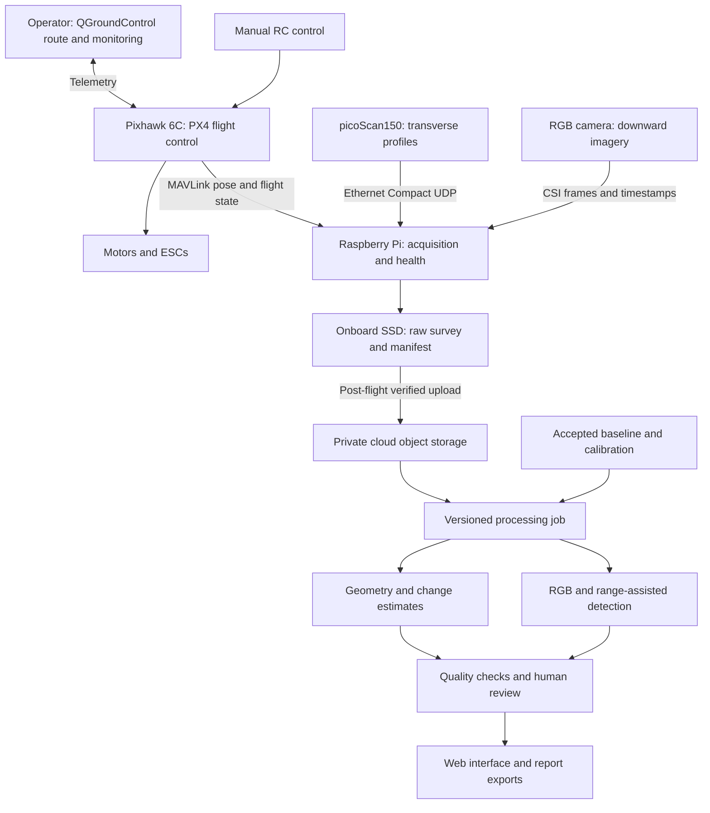

# PaveWatch

## Technical Development and Validation Plan

**Mississippi State University · SICK$10K Challenge, 2026–2027**  
**Team:** Shisir Baral, Pritam Adhikari, Abhinav Dhakal, Ankit Dhakal, Saugat Karki, and Aalok Uprety  
**Faculty advisor:** Jingdao Chen  
**Design revision:** September 19, 2026

### 1. Project purpose

PaveWatch is a proposed UAV system for detecting and tracking changes in paved surfaces. Sidewalks, parking areas, and roads develop heave, settlement, depressions, edge damage, and cracks over time. Periodic visual inspection can identify visible defects, but it is difficult to establish how much a surface has changed when successive inspections lack comparable measurements.

PaveWatch will combine SICK picoScan150 range profiles, RGB imagery, and vehicle motion records into repeatable surveys. After each flight, a cloud processing service will align the observations with an accepted baseline and produce a report showing candidate changes, supporting images, geometric evidence, and uncertainty. The intended users are facilities engineers and maintenance personnel deciding where to conduct a closer inspection.

The first demonstration will cover a controlled sidewalk or parking-area segment. This provides a manageable setting for repeated observations and independent reference measurements while retaining a path toward other paved environments.

The project is at the design stage. The team has completed investigations covering flight hardware, sensing, synchronization, onboard acquisition, missions, processing, datasets, and reporting. Hardware integration, software experiments, and field validation are planned. This document describes the proposed implementation and the evidence that will be required to evaluate it.

### 2. What the prototype will establish

The prototype has two connected research objectives:

1. Determine which pavement elevation changes can be measured repeatably using a moving picoScan150, calibrated sensor geometry, and independently checked survey registration.
2. Evaluate whether adding range and surface-shape information improves image-based defect detection compared with an image-only baseline on the same observations.

The initial geometric targets are raised steps, broad heave, settlement, and pothole-like depressions. Controlled fixtures will span several dimensions and heights so the team can establish a detectable range instead of assuming one. Crack-like features will be evaluated primarily through imagery. Fine crack width is not an assumed capability of the 2D LiDAR or of imagery collected at an arbitrary flight altitude.

Success means producing a traceable baseline/current comparison whose errors and limitations are measured. Detection accuracy, flight endurance, inspection savings, and minimum detectable deformation will be reported after testing.

### 3. Why the picoScan150 is central

The picoScan150 adds direct range evidence to pavement images. PaveWatch will orient its scan plane across the direction of travel so successive scans sample pavement cross-sections. Translation supplies the second spatial dimension; synchronized position and attitude estimates allow those profiles to be placed in a common survey frame.

The sensor's compact package supports payload integration, while its configurable scanning and Ethernet output allow the team to investigate the relationship between sampling, flight motion, and data quality. Echo and signal-strength information will be retained to study unreliable returns around edges and surface contamination. Its outdoor-oriented design makes it relevant to this application, although the complete payload will begin testing in dry conditions. Exact range, scan combinations, and optional timing/IMU features depend on the supplied variant and configuration. [1, 2]

The contribution is the combined measurement workflow: collect range profiles, associate them with appearance, align successive visits, and show where the evidence supports a change. RGB supplies visual context; LiDAR supplies an independently acquired geometric channel.

### 4. End-to-end architecture

Flight control remains on Pixhawk. The Pi records payload data and reports acquisition health. Cloud connectivity is used after landing, so survey capture does not depend on an airborne internet link. The same processing package will support local replay for development and recovery.

The system will preserve a clear chain from each report item to its survey, raw files, calibration, algorithm version, and baseline. Incomplete acquisition or failed registration will produce a quality report rather than an unsupported statement that no change occurred.
