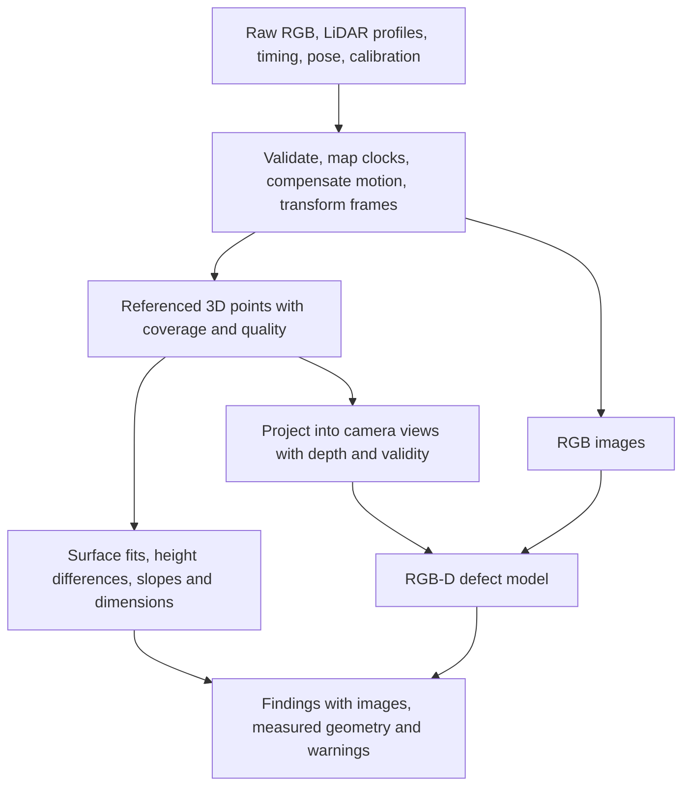

# RGB and depth fusion proposal

November 3, 2026. **Status: user-proposed direction, assessed as feasible in principle; representation and model remain unselected.** This is a design assessment, with no implementation, training, new inventory confirmation, or project measurements. Evidence: [dated research note](../../references/new-evidence/2026-11-03-rgb-depth-fusion.md). Shared timing, transforms, and data-product semantics belong in [integration](../../integration/time-and-frames.md).

## Goal and fit with the current plan

The user proposes correlating RGB images and LiDAR across time, forming images with an additional depth channel, then training a model to identify surface concerns using collected and possibly synthetic data. This is an established RGB-D fusion approach. It is a candidate implementation of PC2, rather than a new subsystem or a requirement for onboard inference.

The current workspace requires a **single-survey assessment**: referenced geometry, visible distress, and reviewable findings. Prior-survey change detection is optional (D-004). Historical SRC-025/SRC-026 recommend an offline geometry branch and an RGB branch, followed by a paired RGB-only versus RGB-plus-shape experiment. Some historical passages require an earlier baseline; that requirement does not carry into the current scope. Distinguish an RGB-only *model baseline* from a prior *survey baseline*.

Proposed responsibilities: SA retains raw images/scans and acquisition metadata; FP/SA supply referenced pose and calibration inputs; PC builds geometry, derived images, and detections; RD presents source evidence, supported measurements, and quality warnings. GC supplies the post-flight transfer workflow. DT preserves acquisition fault/gap evidence.

## What a depth view should contain

Start with camera-aligned RGB plus sparse metric depth and a validity mask. The four conceptual channels are R, G, B, and D; a separate mask tells the model which depth values are supported. Preserve depth as numerical data with units and a declared definition, alongside the RGB file. A four-channel neural-network input is not an RGBA photograph: its fourth channel represents depth, not transparency. Existing RGB networks need an adapted input layer or a separate depth encoder and retraining/fine-tuning.

For inspection, also evaluate signed height relative to a local reference surface. Camera depth changes when the rig rises or tilts; reference-relative height more directly describes a depression or raised edge. Keep absolute geometry and the reference fit so height normalization is reversible. Define the reference neighborhood carefully: a fit through the defect can erase the defect, while a global flat-plane assumption can mistake pavement grade for damage.

Camera views are the simplest initial product for using existing RGB labels. A later metric top-down tile containing RGB, surface elevation/residual, and coverage can give consistent meters per pixel for measuring footprints. It requires validated mapping/orthorectification; it is an alternative derived view, not an accuracy improvement by itself. A surface grid is 2.5D and cannot preserve every vertical face or occlusion. Keep source profiles and 3D points.

## The main feasibility constraint: sparse moving profiles

SICK documents picoScan100 as a single-plane 2D sensor. A scan overlapping an image usually supplies a narrow trace, not depth for every pixel. Motion perpendicular to the scan plane supplies the other surface dimension. Accumulation needs acquisition-time position/orientation, camera intrinsics/distortion, rigid mounting transforms, and clock mapping. Matching timestamps alone is insufficient; each accumulated point must be transformed from its acquisition pose into the chosen image's pose, with visibility checks. Moving objects should be rejected or flagged.

The exact delivered picoScan variant/licenses/mode and camera exposure/timing remain unknown. Consider the existing **proposed** 15 Hz / 0.33° mode only as a calculation case:

| Quantity | Idealized calculation | Implication |
| --- | --- | --- |
| Along-track spacing at 1–2 m/s | speed / 15 Hz = approximately 67–133 mm | Useful support for broad features; no dense depth at camera-pixel resolution |
| Across-track spacing near nadir at 5–8 m | height × tan(0.33°) = approximately 29–46 mm | A 20 mm crack is not reliably resolved in depth; edges/off-nadir geometry worsen spacing |
| Translation during a 20 ms time error | speed × 0.020 s = 20–40 mm | Passing SA2 alone does not establish S3; angular motion adds further error |

These are engineering calculations for a flat surface, uniform translation, a transverse scan plane, and ideal valid returns. They exclude beam footprint, noise, occlusion, pose/calibration errors, and filtering. They are not achieved resolutions or detection guarantees. A dense rendered image does not increase physical sampling. Broad depressions/steps are a more plausible geometry contribution than fine crack depth; RGB remains essential for crack appearance.

## Existing approaches and continued use of 3D methods

Published precedents include FuseNet for RGB-D segmentation, Sparse-to-Dense for predicting dense depth from RGB and sparse measurements, SHREC 2022 pavement RGB-D segmentation, and PointPainting for adding image-derived class information to 3D points. See the evidence note for sources and limitations. None is a validated PaveWatch model.

Continue using 3D algorithms for robust surface/plane fitting, normals, gradients, clustering, physical dimensions, and optional repeat-survey comparison. Feed those geometric features into an image model, or project its predicted labels back onto measured points. Valid camera-axis depth with intrinsics can be back-projected into XYZ; a metric elevation grid needs its origin, axes, spacing, and elevation datum. A residual-only image without its reference cannot recover absolute geometry. Neither representation recovers occluded or unsampled points.

Pretrained 3D vehicle-detection weights are not immediately suitable for pavement defects or swept single-plane sampling. Reuse geometry and fusion methods; assess model architecture/weights against the actual task and data distribution.

## Proposed experiment sequence

1. **Establish alignment.** Use a stand/carriage, textured measured step/ramp/depression fixtures, and independent timing/pose references. Demonstrate scan/image projection and visible coverage before training a fusion model. Calibration targets cannot also be scored checkpoints.
2. **Exercise paired data.** SRC-026 already identifies the Stereo Pothole dataset, whose maintainer supplies RGB, disparity, point clouds, and pixel labels. It can test the fusion workflow. Its ground-vehicle stereo geometry is not picoScan or aerial evidence. Disparity needs valid camera parameters for conversion to metric depth. Unpaired aerial RGB and unrelated geometry must not be presented as measured RGB-D pairs.
3. **Generate controlled synthetic pairs.** Create a 3D surface with known defects, render the RGB view, and sample the same scene with a moving single-plane scanner. Retain dense ground truth separately from sparse model inputs. Vary crack geometry/texture, shadows, staining, patches, pavement grade, scan phase, motion, calibration/time/pose errors, invalid returns, noise, blur, and occlusion. Include harmless dark marks and depth-only defects so labels cannot be solved just by color. Analytic fixtures test code; realistic rendering and noise require later validation. An AI-generated photo alone is not metric depth truth.
4. **Compare on identical held-out groups.** Evaluate RGB-only, geometry-only, and RGB-plus-depth/mask; then optionally add reference-relative height or learned depth completion. Start with a simple feature classifier or modest segmentation model. Split by physical site/defect and acquisition sequence before tiling or augmentation; keep repeated views together. Freeze thresholds on validation data and score independent real fixtures/sites. Synthetic-only results establish software behavior, not field accuracy.
5. **Keep measurement evidence separate.** A detector proposes a defect region; supported geometry measures it. Preserve observed versus interpolated versus learned depth provenance. Learned completion is an estimate and must be validated independently before supporting quantitative claims. Missing geometry produces an image-only finding or a coverage warning, not an assumed flat or defect-free surface.

Acceptance still follows S2/S3/S5 and PC1/PC2: geometry recall/precision, jointly scored height/centroid error, and per-class visual precision/recall. Also report segmentation IoU where masks exist, projection residuals, actual depth coverage, false positives on nuisance regions, and results with depth missing/misaligned. No fusion improvement threshold or gradient-error limit is added by this proposal.

## Resources, operation, and open choices

Process after acquisition on a laptop/workstation; local versus cloud deployment remains Q-11. This proposal adds no selected airborne hardware, mass, power, or purchase rows. Existing power/mass allocations remain unresolved. Derived arrays, synthetic datasets, checkpoints, training time, backup storage, and an optional GPU/cloud bill need measurement and later pricing; no workstation availability, free compute, or funded service is inferred. The ground-demo and recurring cost scopes remain unpriced.

Version raw-data hashes, time mappings, calibration, preprocessing, dataset groups, model weights, and parameters. A failed stage should leave raw evidence available; reruns write a new derived run. Replacing/remounting a sensor invalidates the relevant calibration until rechecked. Reports retain run/source links and distinguish model confidence from measurement uncertainty and coverage. Intermediate caches may be regenerated; raw evidence and final evaluation provenance need an agreed retention plan with RD.

Q-16 tracks the next design choice: use camera-aligned sparse RGB-D first, or prioritize metric top-down RGB/elevation tiles. The recommendation is camera views for the first paired experiment, with both derived from retained 3D geometry. Q-01/03/06/07/11/12 remain prerequisites for a final hardware-backed design. No substantial implementation is part of this assessment.
