# Functional architecture to refine

The diagram describes responsibilities and expected exchanges. It is not a final wiring diagram or a selection of connectors, radios, firmware, or power components.

```mermaid
flowchart TD
    OP[Operator and ground station] <-->|Mission commands and status| FC[Flight controller and navigation]
    RC[Manual RC] --> FC
    FC --> PROP[ESCs and motors]
    BAT[Flight battery] --> PWR[Power monitoring and distribution]
    PWR --> FC
    PWR --> PROP
    PWR --> PP[Payload power branches]
    PP --> L[Supplied picoScan]
    PP --> REC[Recorder, camera, storage and cooling]
    L -->|Ethernet range packets| REC
    CAM[Downward camera] -->|Images and capture timing| REC
    FC -->|Timestamped pose and flight state| REC
    REC --> SSD[Onboard survey package]
    FC --> DT[Diagnostics and telemetry]
    REC --> DT
    DT -->|Health and faults| OP
    SSD -->|Verified post-flight transfer| PC[Offboard processing]
    PC --> RD[Findings, images, geometry and warnings]
    RD --> REVIEW[Maintenance reviewer]
```

The flight controller controls the aircraft; the recorder captures payload evidence. Raw LiDAR and imagery stay onboard during flight in the existing plans. Low-rate commands/health use ground communications; post-flight transfer carries the bulk data. The exact diagnostics transport and GC3 buffered stream remain open. Flight control must have a defined response when the payload recorder fails.

The LiDAR supplies 2D cross-sections; vehicle or ground-rig motion and referenced pose supply surface coverage. Camera/LiDAR placement and timing must support the common frame used in processing. A single known launch coordinate does not establish reconstruction scale, orientation, or centimeter accuracy. LiDAR slant range is not automatically camera height above uneven ground.

The latest planning approach favors offline camera-position estimation with available GPS/LiDAR/control support as an option. Decide its inputs and validation alongside the physical sensor arrangement. Cloud hosting and historical comparison are unresolved extension choices; keep a usable single-survey processing/export path.

Operational scenarios to complete: bench commissioning; preflight configuration; start/stop capture; normal mission/manual takeover; low energy/link loss/recorder loss; landing and orderly shutdown; integrity-checked export; offline processing; review; replacement/remounting and recalibration. Cross-subsystem details belong in [interfaces](../integration/interfaces.csv), [assembly planning](../integration/assembly-plan.md), and [timing/frames](../integration/time-and-frames.md).
