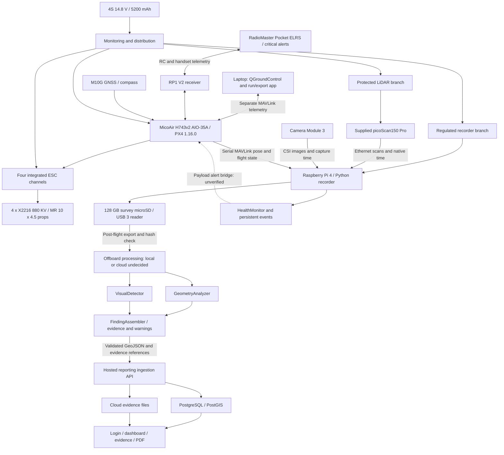

# Current functional architecture — PW-APPROACH-01

Updated November 16, 2026 from SRC-034 §§3.2–3.4. Component names are document selections; connections below are intended contracts pending the pin/power/firmware checks in [interfaces](../integration/interfaces.csv). This is not an executable wiring diagram.

FP owns aircraft/control and power distribution; DT owns health observability; SA owns the Pi capture/storage; GC owns missions and communications; PC owns post-flight analysis; RD owns the portal/database/evidence. Shared power/mounting/timing live in integration, with one BOM owner per component.

Flight control continues to own stabilization and recovery if the recorder fails. Raw imagery/ranges remain onboard during flight; only low-rate commands/status use operational radios. Pocket alert forwarding needs a supported PX4/ELRS/EdgeTX bridge. The separate laptop MAVLink radio is still to be specified; GC3's historical buffer stream remains undefined.

Each 2D LiDAR cross-section needs acquisition-time pose to reconstruct pavement. Rigid sensor calibration, native/common clock mapping, original pose retention, and independent references are required. Post-processed image alignment is a candidate improvement, not a guarantee. Local survey coordinates need origin/axes/scale/datum and a documented geographic conversion; an origin alone does not establish accuracy.

The baseline produces findings from one survey. Prior-survey comparison and learned RGB-D fusion are optional. **Hosted reporting is selected; processing deployment remains open.** A local SQLite review app is a fallback. The [source note](../references/new-evidence/2026-11-16-final-approach.md) tracks speed, energy, budget, and schema conflicts.

Commission in stages: ground power/capture/timing/telemetry, measured-pose stand/carriage and processing, installed commissioning, then authorized loaded flights. No step is presumed passed from the architecture diagram.
